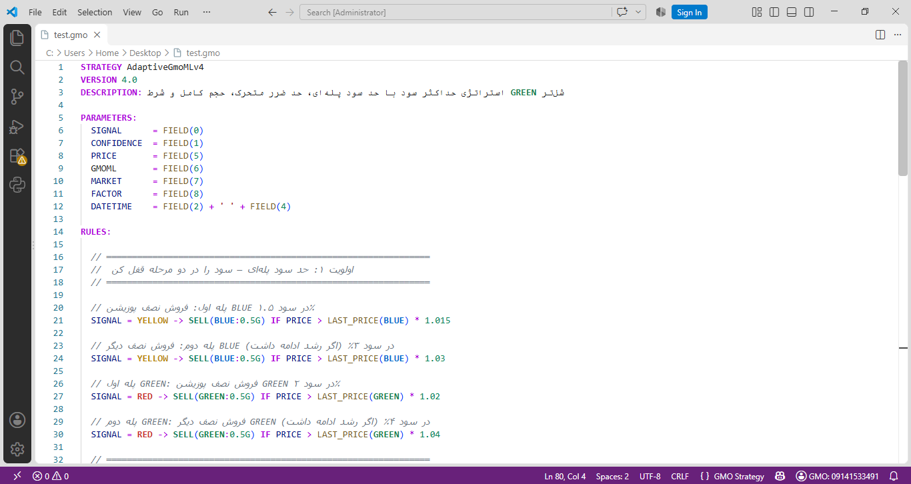
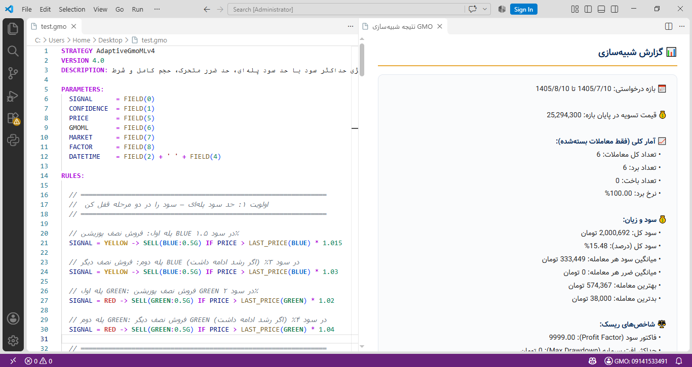

# GMO Strategy Language for VS Code

> The official VS Code extension for writing, testing, and backtesting gold trading strategies — right inside your editor.


**GMO Strategy Language (GML)** is a domain-specific language (DSL) designed for defining gold trading strategies in the **Smart Gold Trading Decision Assistant** ecosystem. This extension brings full language support, syntax highlighting, and backtesting capabilities directly into VS Code.

Whether you're a beginner writing your first trading rule or an experienced trader building advanced multi-condition strategies, this extension makes the process fast, comfortable, and reliable.

---

## 📖 What is GMO Strategy Language?

The GMO ecosystem consists of four connected components:

| Component | Role |
|---|---|
| 🧠 **GoldAI** | The analysis engine that generates buy/sell signals in real time |
| 📊 **GMO Panel** | Web interface for viewing signals, charts, analyses, and news |
| 📝 **GMO Strategy Language** | The DSL for writing trading strategies |
| 🧪 **Backtest Simulator** | Test strategies against historical market data |

### Signal Types

Every signal produced by GoldAI is color-coded:

- 🟢 **GREEN** — Strong buy signal
- 🔵 **BLUE** — Weak buy signal
- 🔴 **RED** — Strong sell signal
- 🟡 **YELLOW** — Weak sell signal

Each signal includes a **confidence percentage** and a **performance index**, helping you make informed decisions.

---

## ✨ Features

### 🎨 Smart Syntax Highlighting
- Color-coded keywords, signals, functions, and values
- Automatic line numbering
- Live cursor position indicator (Ln, Col)
- Dedicated GMO theme (light and dark variants)
- `.gmo` file recognition out of the box

### ⚡ Ready-to-Use Snippets
- Complete strategy template in one command
- Snippets for `BUY`, `SELL`, `IF`, and all statistical functions
- Auto-completion with `Ctrl+Space`

### 🧪 One-Click Backtesting
- Run your strategy directly from VS Code
- Choose between 30-day or 60-day test windows
- View detailed reports and code interpretations in a side panel
- Full Persian text rendering with Yekan font and RTL layout

### 🔐 Secure Authentication
- Login once, stay logged in
- Credentials stored securely using VS Code's native secret storage
- Status bar indicator shows your current session

### 💾 Local Storage
- Every `.gmo` file lives in your own project
- Use Git to version-control your strategies
- No data is sent automatically without your action

---

## 🚀 Installation

### Option 1: VS Code Marketplace (Recommended)

1. Open VS Code
2. Press `Ctrl+Shift+X` to open the Extensions panel
3. Search for **GMO Strategy**
4. Click **Install**

### Option 2: Manual Installation (`.vsix`)

1. Download the `gmo-strategy-x.x.x.vsix` file from the GMO panel or the project repository
2. In VS Code: `Ctrl+Shift+X` → click `...` → **Install from VSIX...**
3. Select the `.vsix` file
4. Reload VS Code after installation

### Prerequisites

- **VS Code** version 1.80 or later
- An **active account** on the [Smart Gold Trading Decision Assistant](https://www.ghadirinews.ir/news/economy/bank/tools/gold-market/)
- An **active subscription** (required for backtesting)

---

## ⚡ Quick Start (30 Seconds)

### 1. Create a New File

Save a new file with the `.gmo` extension:

```
Ctrl+N → Ctrl+S → my-first-strategy.gmo
```

### 2. Write a Simple Strategy

```gmo
STRATEGY MyFirst
VERSION 1.0

PARAMETERS:
  SIGNAL = FIELD(0)

RULES:
  SIGNAL = GREEN -> BUY(1G)
  SIGNAL = RED   -> SELL(1G)
END
```

### 3. Log In

Press `Ctrl+Shift+P`, type `GMO: Login`, and hit Enter.

Enter your registered phone number and password.

### 4. Run the Backtest

Press `Ctrl+Shift+B`, select a time window, and view your results in a side panel. 🎉

---

## 📚 Complete Guide

### Strategy Structure

Every strategy is composed of four parts:

```gmo
STRATEGY StrategyName        ← Required: strategy name
VERSION 1.0                  ← Required: version
DESCRIPTION: Optional text   ← Optional description

PARAMETERS:                  ← Define variables
  SIGNAL     = FIELD(0)
  CONFIDENCE = FIELD(1)
  PRICE      = FIELD(5)

RULES:                       ← Trading rules
  SIGNAL = GREEN -> BUY(1G) IF CONFIDENCE > 70
  SIGNAL = RED   -> SELL(1G) IF PRICE > 5000000
END                          ← Required: end of strategy
```

### Signal Fields (FIELD)

Each signal record contains 9 fields:

| Index | Field | Type | Example |
|---|---|---|---|
| `0` | Signal name | String | `GREEN`, `RED`, `BLUE`, `YELLOW` |
| `1` | Confidence | Number | `75.5` |
| `2` | Gregorian date | Date | `2024/08/05` |
| `3` | Hijri Shamsi date | String | `1403/05/15` |
| `4` | Time | Time | `14:30:25` |
| `5` | Price | Number | `5000000` |
| `6` | GmoML recommendation | Number | `0` to `4` |
| `7` | Market regime | Number | `-1`, `0`, `1` |
| `8` | Signal trigger factor | Number | `0`, `1`, `2` |

### Statistical Functions

| Function | Description |
|---|---|
| `LAST_CONFIDENCE(SIGNAL)` | Last confidence of the given signal |
| `LAST_PRICE(SIGNAL)` | Last price of the given signal |
| `LAST_DATETIME(SIGNAL, offset)` | Last date-time with time offset |
| `MIN_CONFIDENCE(SIGNAL, N)` | Minimum confidence of the last N signals |
| `MAX_CONFIDENCE(SIGNAL, N)` | Maximum confidence of the last N signals |
| `AVG_CONFIDENCE(SIGNAL, N)` | Average confidence of the last N signals |
| `MIN_PRICE(SIGNAL, N)` | Minimum price of the last N signals |
| `MAX_PRICE(SIGNAL, N)` | Maximum price of the last N signals |
| `AVG_PRICE(SIGNAL, N)` | Average price of the last N signals |

### Action Functions

**Buy:**

```gmo
BUY(1G)                    // Buy 1 gram in default CASH source
BUY(GREEN:1G)              // Buy 1 gram in GREEN source
BUY(BLUE:0.5G, GREEN:0.5G) // Buy in multiple sources
```

**Sell:**

```gmo
SELL(1G)                   // Sell 1 gram from CASH
SELL(GREEN:1G)             // Sell 1 gram from GREEN source
SELL(BLUE:0.5G, GREEN:1G)  // Sell from multiple sources
```

> ⚠️ **Important:** `SELL(1G)` only sells from the `CASH` source. To sell from other sources, specify them explicitly.

### Operators

| Operator | Meaning |
|---|---|
| `>` `<` `>=` `<=` | Comparison |
| `=` `<>` | Equal / Not equal |
| `AND` `OR` `NOT` | Logical operators |

---

## 📝 Available Snippets

Type the prefix and press `Tab`:

| Snippet | Result |
|---|---|
| `gmo-strategy` | Complete strategy template |
| `gmo-buy` | A buy rule |
| `gmo-sell` | A sell rule |
| `gmo-buy-multi` | Multi-source buy |
| `gmo-sell-multi` | Multi-source sell |
| `gmo-last-conf` | `LAST_CONFIDENCE(GREEN)` |
| `gmo-last-dt` | `LAST_DATETIME(RED, 36H)` |

---

## ⌨️ Commands & Keyboard Shortcuts

| Command | Shortcut | Description |
|---|---|---|
| `GMO: Login` | — | Log into your account |
| `GMO: Logout` | — | Log out |
| `GMO: Run Backtest` | `Ctrl+Shift+B` | Run a backtest simulation |
| `GMO: Show Token` | — | Debug: view authentication status |

> 💡 You can also **right-click** inside any `.gmo` file and choose **"GMO: Run Backtest"**.

---

## 🎨 Example Strategies

### 1) Conservative (Simple)

```gmo
STRATEGY Conservative
VERSION 1.0

PARAMETERS:
  SIGNAL = FIELD(0)

RULES:
  SIGNAL = GREEN -> BUY(1G)
  SIGNAL = RED   -> SELL(1G)
END
```

### 2) Upward Confidence

Only trades when the current signal's confidence is higher than the last same-named signal:

```gmo
STRATEGY UpwardConfidence
VERSION 1.1

PARAMETERS:
  SIGNAL     = FIELD(0)
  CONFIDENCE = FIELD(1)

RULES:
  SIGNAL = GREEN  -> BUY(1G)   IF CONFIDENCE > LAST_CONFIDENCE(GREEN)
  SIGNAL = BLUE   -> BUY(0.5G) IF CONFIDENCE > LAST_CONFIDENCE(BLUE)
  SIGNAL = YELLOW -> SELL(0.5G) IF CONFIDENCE > LAST_CONFIDENCE(YELLOW)
  SIGNAL = RED    -> SELL(1G)  IF CONFIDENCE > LAST_CONFIDENCE(RED)
END
```

### 3) Tiered Long-Term

Gradual buying with separate sources:

```gmo
STRATEGY LongTerm
VERSION 1.0

PARAMETERS:
  SIGNAL = FIELD(0)

RULES:
  SIGNAL = GREEN  -> BUY(1G)
  SIGNAL = BLUE   -> BUY(0.5G)
  SIGNAL = YELLOW -> SELL(BLUE:0.5G)
  SIGNAL = RED    -> SELL(BLUE:0.5G, GREEN:1G)
END
```

### 4) Profitable Sale

Only sells when there is at least a 1% profit:

```gmo
STRATEGY ProfitableSale
VERSION 1.0

PARAMETERS:
  SIGNAL = FIELD(0)
  PRICE  = FIELD(5)

RULES:
  SIGNAL = GREEN  -> BUY(1G)
  SIGNAL = BLUE   -> BUY(1G)
  SIGNAL = YELLOW -> SELL(1G) IF PRICE > LAST_PRICE(BLUE) * 1.01
  SIGNAL = RED    -> SELL(1G) IF PRICE > LAST_PRICE(GREEN) * 1.01
END
```

### 5) Market-Aware

Trades only in the direction of the market trend:

```gmo
STRATEGY MarketAware
VERSION 1.0

PARAMETERS:
  SIGNAL = FIELD(0)
  MARKET = FIELD(7)

RULES:
  SIGNAL = GREEN  -> BUY(1G)   IF MARKET = 1 OR MARKET = 0
  SIGNAL = BLUE   -> BUY(0.5G) IF MARKET = 1
  SIGNAL = RED    -> SELL(1G)  IF MARKET = -1 OR MARKET = 0
  SIGNAL = YELLOW -> SELL(0.5G) IF MARKET = -1
END
```

### 6) Hybrid (GMO + GmoML)

Trades only when both the signal and GmoML recommendation agree:

```gmo
STRATEGY HybridGMO
VERSION 1.1

PARAMETERS:
  SIGNAL     = FIELD(0)
  CONFIDENCE = FIELD(1)
  GmoML      = FIELD(6)

RULES:
  SIGNAL = GREEN  -> BUY(1G)   IF GmoML = 1 AND CONFIDENCE > 70
  SIGNAL = BLUE   -> BUY(0.5G) IF GmoML = 1 OR GmoML = 3
  SIGNAL = RED    -> SELL(1G)  IF GmoML = 2
  SIGNAL = YELLOW -> SELL(0.5G) IF GmoML = 2 OR GmoML = 4
END
```

> 📚 For more examples and the complete reference, visit the [GMO Strategy Documentation](https://www.ghadirinews.ir/news/economy/bank/tools/gold-market/strategy/reference/).

---

## 🖼️ Screenshots

### Editor with Syntax Highlighting


### Backtest Result Panel


---

## 🐛 Troubleshooting

### ❓ My `.gmo` file isn't highlighted

1. Make sure the file is saved with the `.gmo` extension
2. The bottom-right corner of VS Code should display **GMO Strategy**, not Plain Text
3. If it shows Plain Text: `Ctrl+Shift+P` → `Change Language Mode` → `GMO Strategy`
4. If it still doesn't work: reload VS Code (`Ctrl+Shift+P` → `Reload Window`)

### ❓ The GMO theme isn't applying

Press `Ctrl+K`, then `Ctrl+T`, and choose **GMO Strategy** from the list.

### ❓ `Ctrl+Shift+B` doesn't work

Use the Command Palette instead: `Ctrl+Shift+P` → type `GMO` → **GMO: Run Backtest**

### ❓ I get an error when running the backtest

1. Make sure you're logged in (the Status Bar at the bottom of VS Code should display your phone number)
2. If the Status Bar shows "GMO: Login", press `Ctrl+Shift+P` → `GMO: Login`
3. If your subscription has expired, renew it on the [Smart Gold Trading Decision Assistant](https://www.ghadirinews.ir/news/economy/bank/tools/gold-market/)

### ❓ The backtest results don't appear

1. Open VS Code's Developer Tools: `Help` → `Toggle Developer Tools` → **Console** tab
2. Look for lines starting with `[GMO]`
3. If you see network errors, check your internet connection

### ❓ Snippets don't work

- Make sure the file has the `.gmo` extension
- Press `Ctrl+Space` manually to open the snippet menu
- Reload VS Code

---

## 🤝 Contributing

Found a bug or have a feature suggestion? Reach out to us through the Smart Gold Trading Decision Assistant platform.

---

## 📄 License

Copyright (c) 2026 Ghadiri News Agency — GMO Strategy Language Project.

All rights reserved. This extension is part of the **Smart Gold Trading
Decision Assistant** ecosystem and is the proprietary property of
[Ghadiri News Agency](https://www.ghadirinews.ir). Unauthorized use,
copying, or distribution is strictly prohibited.

Using this extension requires an **active account** on the Smart Gold
Trading Decision Assistant platform.

---

## 🔗 Useful Links

| Resource | Description |
|---|---|
| [🏠 Smart Gold Trading Decision Assistant](https://www.ghadirinews.ir/news/economy/bank/tools/gold-market/) | Main platform, performance stats |
| [📝 GMO Strategy Introduction](https://www.ghadirinews.ir/news/economy/bank/tools/gold-market/strategy/) | Overview and examples |
| [📚 GMO Strategy Reference](https://www.ghadirinews.ir/news/economy/bank/tools/gold-market/strategy/reference/) | Full function and keyword reference |
| [📊 GMO Panel](https://www.ghadirinews.ir/news/economy/bank/tools/gold-market/online/) | Live signals and analyses |
| [🧪 Online Backtest Simulator](https://www.ghadirinews.ir/news/economy/bank/tools/gold-market/backtest/) | Browser-based simulator |

> 🌐 **Persian documentation** is available in the [GMO Strategy Reference](https://www.ghadirinews.ir/news/economy/bank/tools/gold-market/strategy/reference/).

---

<div align="center">

**We Analyze. You Decide.**

Built with ❤️ for gold traders

[Report a Bug](https://www.ghadirinews.ir/contact/) · [Ghadiri News Agency](https://www.ghadirinews.ir)

</div>
